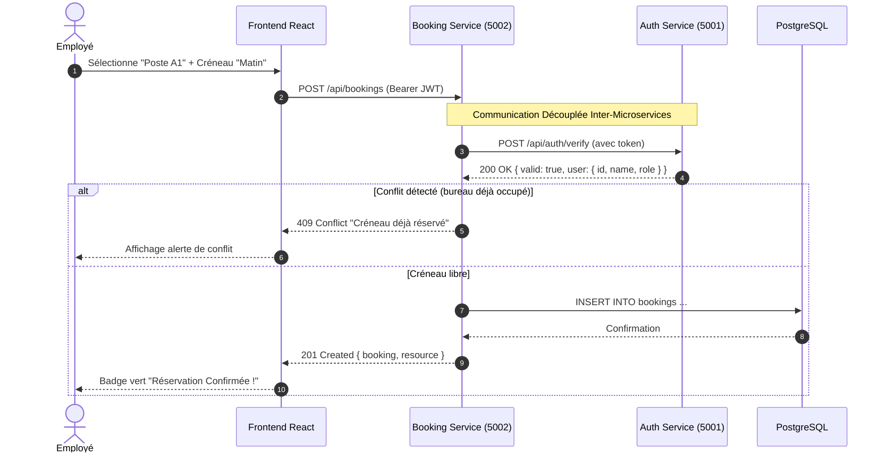

# Architecture Technique & Enjeux Cloud : FlexOffice

Ce document décrit en détail les choix d'architecture, la communication inter-services, les modèles de données et la stratégie CI/CD Cloud pour le système de réservation de bureaux et salles (Flex Office).

---

## 1. Schéma Général de l'Architecture Microservices

```
               +---------------------------------------------------+
               |             Navigateur Client / Employé           |
               +---------------------------------------------------+
                                         |
                                         v
                         +-------------------------------+
                         |   Passerelle Nginx / Ingress  |
                         |           (Port 80)           |
                         +-------------------------------+
                                 /               \
            /api/auth           /                 \  /api/bookings, /api/resources
                               v                   v
              +-----------------------+     +-----------------------+
              |   Service 1 : Auth    |     | Service 2 : Booking   |
              | (Utilisateurs & JWT)  |     | (Calendrier & Conflit)|
              |       Port 5001       |     |       Port 5002       |
              +-----------------------+     +-----------------------+
                          ^                             |
                          |  Vérification Token HTTP    |
                          +-----------------------------+
                                (Inter-Service REST)
                                         |
                                         v
                      +-------------------------------------+
                      |    Base de Données PostgreSQL       |
                      |  (Tables : users, resources,        |
                      |   bookings)                         |
                      +-------------------------------------+
```

---

## 2. Découplage des Microservices & Communication Inter-Services

### Pourquoi deux microservices distincts ?
1. **Service 1 : Auth & Utilisateurs (`services/auth-service`)**
   - **Responsabilité unique** : Gestion des identités, hachage des mots de passe (bcrypt), génération et vérification des jetons JWT, gestion des rôles (`EMPLOYEE`, `MANAGER`, `ADMIN`).
   - Indépendant du domaine métier de réservation : peut être réutilisé par d'autres applications de l'entreprise.
2. **Service 2 : Réservations (`services/booking-service`)**
   - **Responsabilité unique** : Gestion des bureaux flex et salles, calcul des créneaux horaires, prévention des surréservations, métriques d'occupation.
   - Ne stocke pas les mots de passe et ne gère pas la création de comptes.

### Flux de communication inter-services (Diagramme de Séquence)



---

## 3. Algorithme de Détection Anti-Conflit

Trois créneaux horaires sont configurés par ressource et par jour :
- `MORNING` : 08h30 - 12h30
- `AFTERNOON` : 13h30 - 18h00
- `FULL_DAY` : 08h30 - 18h00

### Règles de collision :
| Réservation Existante | Nouvelle Demande : `MORNING` | Nouvelle Demande : `AFTERNOON` | Nouvelle Demande : `FULL_DAY` |
|:---:|:---:|:---:|:---:|
| **Aucune** | ✅ Validé | ✅ Validé | ✅ Validé |
| **`MORNING`** | ❌ Conflit (409) | ✅ Validé (Partage journée) | ❌ Conflit (409) |
| **`AFTERNOON`** | ✅ Validé (Partage journée) | ❌ Conflit (409) | ❌ Conflit (409) |
| **`FULL_DAY`** | ❌ Conflit (409) | ❌ Conflit (409) | ❌ Conflit (409) |

---

## 4. Pipeline CI/CD (GitHub Actions / GitLab CI) & Azure PaaS

```
[ Git Push / Commit ]
         |
         v
+-------------------------------------------------------+
| 1. Stage Test (Parallèle)                             |
|    - Jest Unit Tests : Auth Service (5001)            |
|    - Jest Unit Tests : Booking Service (5002)         |
|    - Build Compilation : React 18 / Vite              |
+-------------------------------------------------------+
         | (Si succès)
         v
+-------------------------------------------------------+
| 2. Stage Build & Registry                             |
|    - Build Docker Image : auth-service:SHA & latest   |
|    - Build Docker Image : booking-service:SHA & latest|
|    - Build Docker Image : frontend:SHA & latest       |
|    - Push vers GitHub Container Registry (ghcr.io)    |
+-------------------------------------------------------+
         | (Branche main)
         v
+-------------------------------------------------------+
| 3. Stage Deploy PaaS (Azure App Service)              |
|    - azure/login via Service Principal                |
|    - Mise à jour multi-container via Compose Azure    |
|    - Déploiement sans coupure (Zero Downtime)         |
+-------------------------------------------------------+
```
